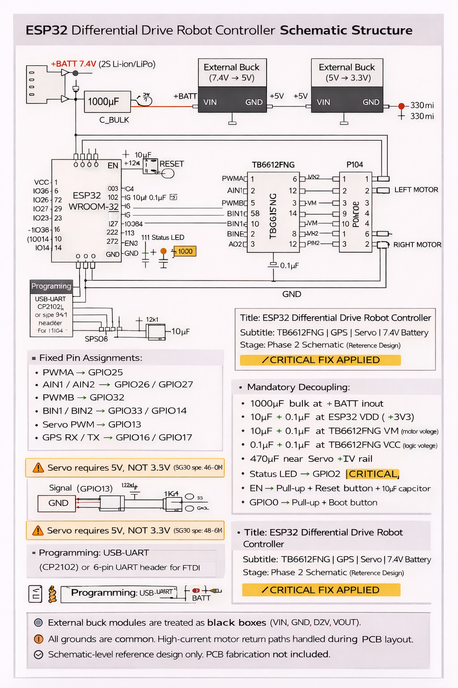

# ESP32 Differential-Drive Robot Firmware

Firmware for a remote-controlled differential-drive robot on an ESP32: GPS tracking, BLE authentication, WebSocket telemetry and ESP32-CAM video.

I set out to build a small robot that an operator can drive and watch over Wi-Fi. It only accepts commands after it has been unlocked over Bluetooth, and it brakes by itself if the link to the server drops. The firmware is organised as a five-state machine with separate modules for motors, the servo, GPS, BLE, networking and the camera. It also comes with a reference schematic for the controller board.

---

## What it does

- **Drive:** two DC motors through a TB6612FNG H-bridge, using ESP32 LEDC PWM (5 kHz, 8-bit). Speed is capped at 200/255. Commands are forward, backward, left, right and stop.
- **Laser aiming:** an SG90 servo, kept between 10° and 170° and centred at 90°.
- **GPS:** a NEO-6M on UART2 at 9600 baud, parsed with TinyGPS++. A fix older than 5 seconds is marked invalid, so stale coordinates aren't reported as current.
- **BLE unlock:** the robot advertises as `ESP32_Robot_001`. Writing the token to the auth characteristic unlocks it, and motor and servo commands are ignored until then. After unlocking, the firmware shuts down the BLE stack to free memory.
- **Wi-Fi and WebSocket:** the robot connects to a WebSocket server and sends JSON telemetry every 2 seconds. It accepts JSON control commands and reconnects with backoff (1 s, doubling up to 8 s).
- **Fail-safes:** the motors brake if the WebSocket closes, or if the server sends nothing for 5 seconds (heartbeat watchdog). From the error state the firmware retries the network after 10 seconds. A connection attempt that takes longer than 30 seconds also counts as an error.
- **Camera:** when built with the `esp32cam` environment, the firmware serves an MJPEG stream on port 81 after BLE unlock. Both `/` and `/stream` return 403 until the robot is unlocked. The default `esp32dev` build leaves the camera out.

## State machine

```
INIT ──> WAIT_AUTH ──[BLE token OK]──> CONNECT_NETWORK ──[WebSocket up]──> OPERATIONAL
              (LED blinks 500 ms)        (30 s timeout)                    (LED on, telemetry every 2 s)
                                              ^                                  │
                                              │                     [link lost or no server
                                              │                      message for 5 s]
                                              │                                  v
                                              └────────[retry after 10 s]──── ERROR
                                                                              (motors braked,
                                                                               LED blinks 250 ms)
```

## Communication protocol

### Telemetry (robot to server, every 2 s)

```json
{
  "bot_id": "ESP32_A1B2C3",
  "timestamp": 123456,
  "gps": { "latitude": 28.613939, "longitude": 77.209021, "fix_valid": true },
  "network": { "connected": true, "rssi": -58, "reconnect_count": 0 },
  "state": "OPERATIONAL",
  "ble_authenticated": true
}
```

`bot_id` is built from the last three bytes of the Wi-Fi MAC address, so several robots can share one server.

### Commands (server to robot)

```json
{"type": "control", "action": "forward", "speed": 150}
{"type": "control", "action": "backward", "speed": 150}
{"type": "control", "action": "left", "speed": 100}
{"type": "control", "action": "right", "speed": 100}
{"type": "control", "action": "stop"}
{"type": "control", "action": "servo", "angle": 90}
```

Commands are only acted on in the `OPERATIONAL` state.

## Hardware

| Component | Part | Notes |
| --- | --- | --- |
| Microcontroller | ESP32-WROOM-32 | Main controller |
| Motor driver | TB6612FNG | Dual H-bridge, 1.2 A per channel |
| DC motors (x2) | N20 6 V geared | Left and right drive |
| Servo | SG90 | 5 V, laser aiming |
| GPS | NEO-6M | UART, 9600 baud |
| Camera | AI-Thinker ESP32-CAM | OV2640 |
| Battery | 7.4 V 2S LiPo, 1000 mAh | Motor and system power |
| Regulators | 5 V and 3.3 V stages | Logic and servo power. Parts are listed in the schematic and BOM |

### Pin mapping

| ESP32 pin | Function | Connects to |
| --- | --- | --- |
| GPIO 25 | Left motor PWM | TB6612FNG PWMA |
| GPIO 26 | Left motor IN1 | TB6612FNG AIN1 |
| GPIO 27 | Left motor IN2 | TB6612FNG AIN2 |
| GPIO 32 | Right motor PWM | TB6612FNG PWMB |
| GPIO 33 | Right motor IN1 | TB6612FNG BIN1 |
| GPIO 14 | Right motor IN2 | TB6612FNG BIN2 |
| GPIO 15 | Motor standby | TB6612FNG STBY |
| GPIO 16 | GPS RX | GPS TX |
| GPIO 17 | GPS TX | GPS RX |
| GPIO 13 | Servo signal | SG90 |
| GPIO 2 | Status LED | LED + 1 kΩ |

The motors run straight from the battery through the TB6612FNG. Logic and the servo run from a separate 5 V / 3.3 V regulated rail, and the two grounds meet at a single point.

## Build and flash

### 1. Clone

```bash
git clone https://github.com/Aryanpanwar10005/ESP32-differential-drive-robot.git
cd ESP32-differential-drive-robot
```

### 2. Configure

Edit `src/config.h`:

```cpp
// WiFi credentials (REQUIRED)
#define WIFI_SSID "YourWiFiSSID"
#define WIFI_PASSWORD "YourWiFiPassword"

// WebSocket server (REQUIRED)
#define WEBSOCKET_SERVER_URL "ws://192.168.1.100:8080/ws"

// BLE unlock token
#define AUTH_TOKEN "SecureToken123"
```

Change the default BLE token (`SecureToken123`) before using this on a real device.

### 3. Build and upload (PlatformIO)

```bash
# Build (library dependencies install automatically)
pio run

# Upload to the ESP32
pio run -t upload

# Serial monitor
pio device monitor -f esp32_exception_decoder --baud 115200

# Camera build for an ESP32-CAM board
pio run -e esp32cam -t upload
```

Libraries, from `platformio.ini`: TinyGPSPlus, ESP32Servo, ArduinoJson 7 and ArduinoWebsockets. Target: `espressif32`, Arduino framework.

## Testing

The `tests/` folder has:

- `motor_test.cpp` and `gps_test.cpp`, standalone sketches for checking the motors and GPS on their own.
- `websocket_test_server.py`, a small Python WebSocket server on port 8080 that the robot can connect to. It sends automated test commands (`pip install -r tests/requirements.txt`, then `python tests/websocket_test_server.py`).
- `ble_test_guide.md`, which covers unlocking the robot with the nRF Connect app.
- `TEST_INSTRUCTIONS.md`, a step-by-step hardware test procedure.

## Documentation

- [API Reference](docs/API_Reference.md): WebSocket protocol
- [Architecture](docs/Architecture.md): design decisions
- [Pin Mapping](docs/Pin_Mapping.md): wiring
- [State Machine](docs/State_Machine.md): states and timing
- [Testing Guide](docs/Testing_Guide.md): test procedures and troubleshooting
- [ESP32-CAM Setup](docs/ESP32_CAM_Setup.md): camera module notes

## Hardware design

[Reference schematic (PDF)](docs/Schematic_Reference_ESP32_Robot_v1.0.pdf)



The schematic covers the ESP32, the TB6612FNG, the GPS and servo connectors, the two-stage regulator chain, reverse-polarity protection (P-channel MOSFET) and a USB-UART programming header. Design notes and a BOM are in `hardware/`.

## Status and known gaps

- The firmware and the reference schematic are done. The PCB layout and Gerber folders under `hardware/` are still placeholders.
- The WebSocket link uses plain `ws://`, not TLS. `docs/Architecture.md` explains this choice for an isolated local network.
- The `motor_test` and `gps_test` environments in `platformio.ini` still point at an old `test/` folder (the sketches now live in `tests/`).
- The separate ESP32-CAM sketch that `esp32_cam_firmware/README.md` describes was removed during a refactor. Camera support now lives in `src/modules/camera_manager.cpp`, behind the `esp32cam` build.
- Connecting to Wi-Fi blocks for up to 10 seconds.

## License

MIT. See [LICENSE](LICENSE).

---

Built by [Aryan Panwar](https://aryanpanwar.in).
